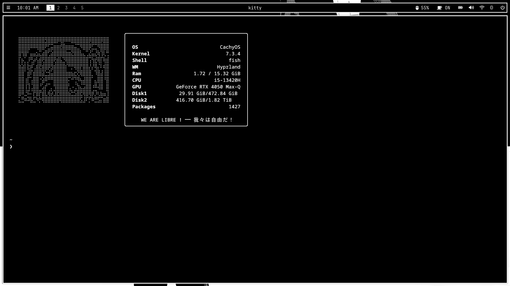

# desktop-setup



## Components
- **WM:** Hyprland (`hyprland.lua`)
- **Bar:** Waybar with live Dark/Light mode, Acrylic blur, Outlines & Rounded toggles
- **Launcher & Menus:** Rofi (`Alt + Space` settings menu, `Super + Space` app launcher)
- **Notifications:** SwayNC
- **Terminal & Fetch:** Kitty + Fastfetch

## Quick Install
```bash
cp -r .config/* ~/.config/
cp Pictures/wallpaper.png ~/Pictures/wallpaper.png
hyprctl reload
```
